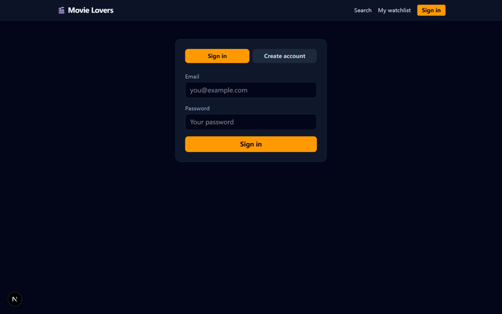
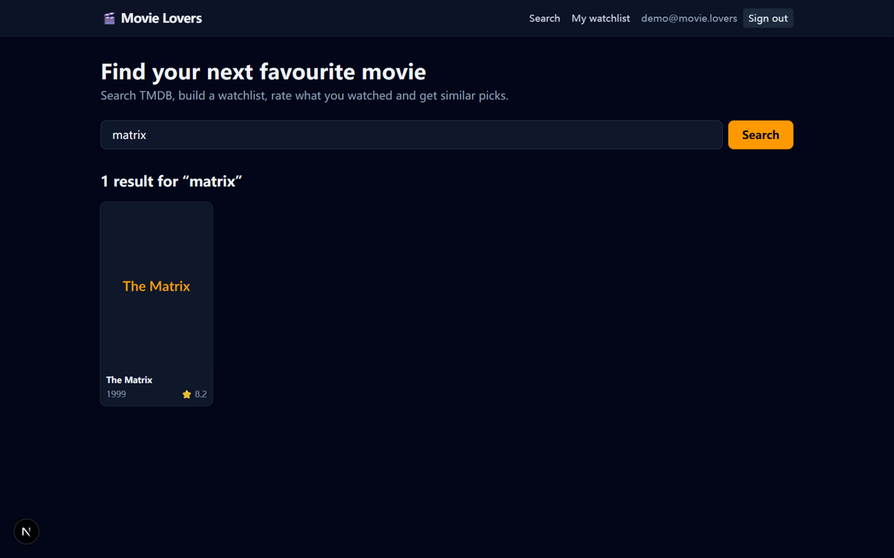
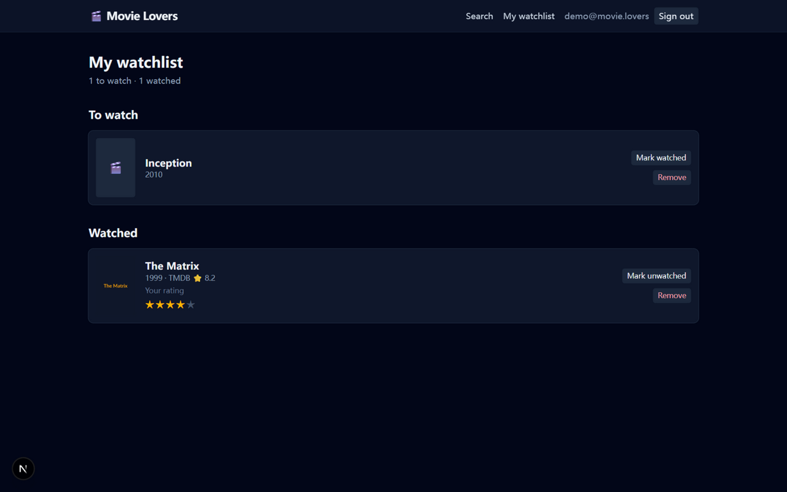
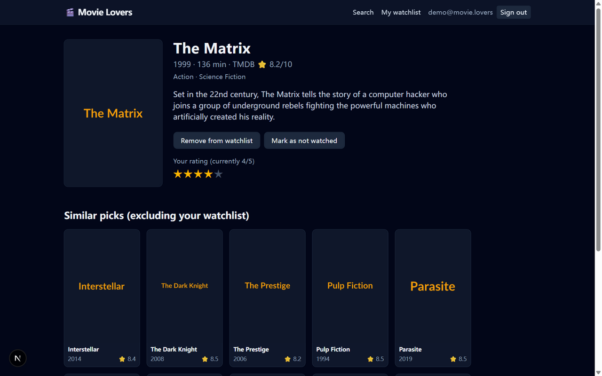

# USER GUIDE — Movie Lovers for film fans

Welcome! Movie Lovers is your personal movie companion. This guide is written
for non-technical film fans — if you can use a web browser, you can use
everything below.

What you can do:

1. **Search** for movies and see their poster, year and TMDB score
2. **Create your own account** (just an email and a password)
3. **Build a watchlist** — movies you want to see
4. **Mark movies as watched** after you've seen them
5. **Rate watched movies** from 1 to 5 stars, and change your rating any time
6. Get **similar picks** for any movie — and the app is polite enough to never
   recommend something that's already on your list

---

## 1. Sign in or create an account

Open the app in your browser. Click **Sign in** in the top-right corner.

- Already have an account? Type your **email** and **password**, then click the
  orange **Sign in** button.
- First time? Click the **Create account** tab, enter your email and a password
  of at least 6 characters, then click **Create account**.

That's all your account is: an email and a password on your own machine. Your
password is stored safely (scrambled beyond recognition), and nobody can read it.

---

## 2. Search for a movie

Type a movie title in the search box on the home page and click **Search**
(or press Enter).

You'll see matching movies as cards with the **poster**, **title**, **year**
and the **TMDB score** (the ⭐ number, out of 10). Click any card to open the
movie's page.

> Tip: search works on partial titles too — "matrix" finds *The Matrix*.

---

## 3. Add a movie to your watchlist

On a movie's page (or in search results), click **+ Add to watchlist**.
The movie is now on your list of "movies I want to watch".

Changed your mind? Open it again and click **Remove from watchlist**.

---

## 4. Mark a movie as watched

After you've seen the movie, tell the app:

- On the movie's page, click **Mark as watched**, or
- On your watchlist page, click **Mark watched** next to the movie.

Your watchlist page splits into two groups — **To watch** and **Watched** — so
you always know what's left. If you click **Mark unwatched** by mistake, just
click **Mark watched** again (note: this also clears any rating you gave it).

---

## 5. Rate a movie (1–5 stars)

You can only rate movies you've actually watched — that's the whole idea.

On the watchlist page, every movie in the **Watched** group shows
**Your rating** with five stars:

Click the star that matches your opinion:

- ★☆☆☆☆ — I want those two hours of my life back
- ★★★★★ — all-time favourite

Click a different star any time to change your rating. The movie's page shows
your current rating too ("Your rating (currently 4/5)").

---

## 6. Similar picks — "what should I watch next?"

Open any movie's page and scroll down to **Similar picks**. You'll see up to
10 movies the app thinks you'll enjoy, based on that movie.

The nice part: **anything already on your watchlist is left out** of the list —
so every suggestion is something new for you. The page even says it in the
heading: *Similar picks (excluding your watchlist)*.

---

## Good to know

- **Where is my data?** On your own computer, in a small database file inside
  the app's `data/` folder. Nothing is sent anywhere except movie lookups.
- **Something looks like demo data?** If the person who set up the app started
  it in demo mode (no internet movie data), you'll see placeholder posters and
  a small demo catalogue. Ask them to follow SETUP.md step 3 to use real TMDB data.
- **Signed out by accident?** Just sign in again — your watchlist and ratings
  are waiting for you.

Enjoy the movies! 🍿
